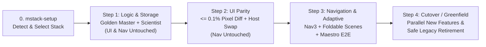
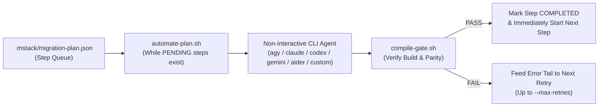

# Mobile Migration Tools (`mstack`)

Inspired by [`poteto/pstack`](https://github.com/cursor/plugins/tree/main/pstack), **`mobile-migration-tools` (`mstack`)** is a self-contained, repository-portable skillset and workflow engine for migrating legacy mobile applications (Android Java/XML, iOS Obj-C/UIKit/Storyboards, React Native, Flutter, Xamarin/MAUI) to modern target architectures with **100% Visual, Behavioral, Navigation, and Business-Logic Parity**.

## Why `mstack` Exists

Most AI-assisted mobile migrations fail in three predictable ways:
1. **The "90% Logic Trap"**: Rewriting legacy business logic by reading code misses undocumented side effects, rounding modes, and null quirks.
2. **Visual Drift**: Converting XML/Storyboards to Compose/SwiftUI by eye alters font padding, margins, density scaling, and custom views.
3. **Navigation Breakage**: Changing UI frameworks and navigation containers in the same step breaks back stacks, deep links, and result passing.

`mstack` eliminates these failures by enforcing **four non-negotiable engineering principles** and **four decoupled execution phases** that **must compile at every atomic step**.

---

## Directory Structure (Standalone Repo Ready)

```text
mobile-migration-tools/
├── package.json                                  # npm / npx package manifest
├── plugin.json                                   # Plugin manifest (Antigravity / Cursor / Claude compatible)
├── README.md                                     # Documentation & architecture guide
├── bin/
│   └── cli.js                                    # Zero-dependency npx installer & CLI runner
├── rules/
│   └── AGENTS.md                                 # Always-on compiler & parity guardrails
├── scripts/
│   ├── detect-project.sh                         # Auto-detects legacy languages, UI, build system, and modules
│   ├── compile-gate.sh                           # Universal Always-Compile gate runner
│   ├── log-evidence.sh                           # Append-only TSV evidence logger (.mstack/audit.tsv)
│   └── automate-plan.sh                          # Long-running non-interactive CLI automation loop
└── skills/
    ├── mstack-mode/SKILL.md                      # Front-door orchestrator (like /poteto-mode)
    ├── mstack-setup/SKILL.md                     # Interactive project detector & target-stack selector
    ├── mstack-automation/SKILL.md                # Non-interactive multi-step automation mode (never stops after 1 step)
    ├── mstack-step1-logic-storage/SKILL.md       # Step 1: Approval Tests + Scientist Shadow Logic + Synced Storage
    ├── mstack-step2-ui-parity/SKILL.md           # Step 2: Golden Master Screenshot Diff + Host Interop UI Swap
    ├── mstack-step3-navigation-adaptive/SKILL.md # Step 3: Decoupled Navigation Upgrade + Foldable/Adaptive Scenes
    ├── mstack-step4-greenfield-cutover/SKILL.md  # Step 4: Parallel New Features & Safe Legacy Decommissioning
    ├── principle-always-compile/SKILL.md         # Principle: Every sub-step must compile & pass its gate
    ├── principle-scientist-parity/SKILL.md       # Principle: Golden Master + Scientist Dual-Execution for 100% logic parity
    ├── principle-visual-golden-master/SKILL.md   # Principle: Pixel-diff against real legacy rendering (<= 0.1% diff)
    └── principle-decouple-ui-and-nav/SKILL.md    # Principle: Never migrate UI and Navigation in the same step
```

---

## Installation & Setup

### Option A: One-Command Install via `npx` (Recommended)

Run from your mobile project's root directory:

```bash
# Install directly from GitHub (or npm if published)
npx github:estines/mobile-migration-tools
# or
npx mobile-migration-tools
```

This automatically:
1. Installs `mobile-migration-tools/` (`skills/`, executable `scripts/`, `rules/`, `plugin.json`) into your workspace.
2. Registers `"mobile-migration-tools/skills"` in `.agents/skills.json`.
3. Installs agent guardrails to `.agents/rules/mstack.md` (pass `--root-agents` to also create/append root `AGENTS.md`).

You can also install individual skills using the Agent Skills CLI:
```bash
npx skills add estines/mobile-migration-tools
```

### Option B: Git Submodule / Manual Setup

1. **Add `mobile-migration-tools` to your workspace** (as a git submodule, cloned folder, or plugin):
   ```bash
   git submodule add https://github.com/estines/mobile-migration-tools.git mobile-migration-tools
   ```
2. **Mount Skills & Rules in Workspace**:
   - **Skills (`.agents/skills.json`)**:
     ```json
     {
       "entries": [
         { "path": "mobile-migration-tools/skills" }
       ]
     }
     ```
   - **Agent Rules**: Reference or copy `mobile-migration-tools/rules/AGENTS.md` into your project's root `AGENTS.md` or `.agents/rules/`.

---

## How to Use `mstack`

### TL;DR

1. **First-time setup (once per repo):**
   > *"Set up mobile-migration-tools for this project."*
   *(Scans your codebase, asks you to pick your target stack via multiple-choice questions, and saves `.mstack/target-profile.json`.)*
2. **Migrate an existing screen or flow (end-to-end or step-by-step):**
   > *"Use `mstack` to migrate `<FeatureOrScreenName>`."*
3. **Build a brand-new feature while migration is ongoing:**
   > *"Use `mstack` greenfield workflow to build `<NewFeatureName>`."*

| Phase | What Changes | What Stays Untouched | Mandatory Gate (`compile-gate.sh`) |
| :--- | :--- | :--- | :--- |
| **0. `mstack-setup`** | Creates `.mstack/target-profile.json` | All app code | Baseline scan (`detect-project.sh`) |
| **1. `step1-logic-storage`** | Domain, mappers, UseCases, Synced Storage Proxy | Legacy UI & Navigation | 100% Golden Master match + `0.00%` Scientist mismatch |
| **2. `step2-ui-parity`** | Declarative UI (`Compose`/`SwiftUI`) inside existing host | Legacy Navigation (`Activity`/`Fragment`/`VC`) | `<= 0.1%` pixel diff vs. real legacy Golden PNG |
| **3. `step3-navigation-adaptive`** | Typed routes (`Nav3` / `NavDisplay`) + Foldable scenes | Domain & UI logic | Backstack unit tests + Foldable recreate + Maestro E2E |
| **4. `step4-greenfield-cutover`** | Parallel new features **or** deletes retired legacy files | Verified target modules | All Steps 1–3 `PASS` + clean repo build |

---

Once mounted, `mstack-mode` acts as the front-door router for any migration, modernization, or greenfield feature task. You can either run a **full end-to-end migration** or execute **individual phases** step by step.



### Phase 0: Configure Your Target Stack (`mstack-setup`)

`mstack` never assumes your target architecture. Before writing any migration code, it inspects your existing repository and asks you to choose your target stack.

**Example Prompt:**
> *"Set up mobile-migration-tools for this project."*

**What happens:**
1. The agent runs `./mobile-migration-tools/scripts/detect-project.sh` to count legacy vs. modern source files (`*.java`, `*.kt`, `res/layout/*.xml`, `*.m`, `*.swift`, `*.storyboard`, `*.dart`, `*.tsx`) and detect your build system.
2. The agent asks you interactive multiple-choice questions to select your:
   - **Target Platform & Module Strategy** (e.g., KMP `:api` + `:impl`, Native Android Compose, Modular SwiftUI)
   - **Presentation Pattern** (e.g., Unidirectional MVI, MVVM)
   - **Navigation & Form-Factor Strategy** (e.g., Navigation 3 + Material 3 Adaptive `SceneStrategy` for Foldables)
   - **Storage & Network Stack** (e.g., Room KMP + DataStore with Synced Legacy Proxy + Ktor)
   - **Verification Gate Tooling** (e.g., Roborazzi JVM pixel diff + Scientist Dual-Execution + Maestro E2E)
3. Your selections are saved to `.mstack/target-profile.json` so all subsequent steps automatically enforce your chosen stack and compile commands.

---

### Phase 1: Migrate Business Logic & Device Storage (`mstack-step1-logic-storage`)

Extracts legacy business rules, calculations, mappers, and persistence into your target architecture while leaving **Legacy UI and Legacy Navigation 100% untouched**.

**Example Prompt:**
> *"Run mstack Step 1 to extract the business logic and storage for the PaymentConfirmation feature."*

**What happens (compiling after every sub-step):**
1. **Sub-Step 1.1 — Golden Master Baseline**: Runs the real untouched legacy class against an exhaustive input matrix (boundaries, rounding modes, nulls, error codes, EN/TH locales) and saves the serialized output as the Golden Master baseline.
2. **Sub-Step 1.2 — Target Module + Synced Storage Proxy**: Scaffolds `:features:<name>:api` + `:impl` and creates a **Read-Through / Dual-Write Storage Proxy** so legacy `SharedPreferences`/SQLite and modern `DataStore`/`Room` stay 100% synchronized with zero split-brain state.
3. **Sub-Step 1.3 — Target Domain Parity**: Implements pure domain models, value classes, and UseCases in `commonMain`, requiring **100.0% match** against the Golden Master suite from 1.1.
4. **Sub-Step 1.4 — Scientist Dual-Execution**: Wires a `Scientist` shadow wrapper inside the legacy host that runs Legacy (`Control`) and New (`Candidate`) in parallel and verifies `0.00%` mismatch.

---

### Phase 2: Migrate UI with Pixel-Exact Parity (`mstack-step2-ui-parity`)

Replaces legacy XML/Storyboard layouts with modern declarative UI (`Compose Multiplatform`, `Jetpack Compose`, `SwiftUI`) while keeping **Legacy Navigation (`Activity`/`Fragment`/`UIViewController`) 100% untouched**.

**Example Prompt:**
> *"Run mstack Step 2 to migrate the PaymentConfirmation XML layout to Compose with visual parity."*

**What happens (compiling after every sub-step):**
1. **Sub-Step 2.1 — Capture Legacy Golden PNGs**: Renders the real legacy XML/View across all screen states (`Loading`, `Content`, `Empty`, `Error`) and locales (`en`, `th`) into Golden Master PNGs.
2. **Sub-Step 2.2 — Declarative UI + Bridge Theme**: Builds stateless `<Screen>Content(state, onEvent)` using a **Legacy-Compat Bridge Theme** (matching font padding, baseline heights, density rules, and preserving original test tags/IDs for QA automation). Complex custom views can be wrapped via `AndroidView` / `UIViewRepresentable` first.
3. **Sub-Step 2.3 — Automated Pixel-Diff Gate**: Runs snapshot comparison against the legacy Golden PNGs. Must pass **`<= 0.1%` pixel difference** before proceeding.
4. **Sub-Step 2.4 — Host Swap**: Replaces `setContentView(R.layout...)` with `ComposeView` / `setContent` inside the existing `Activity` or `Fragment` without altering any `Intent` extras, `setResult` contracts, or navigation transitions.

---

### Phase 3: Upgrade Navigation & Foldable Adaptive Layouts (`mstack-step3-navigation-adaptive`)

Once all screens in a flow have passed Steps 1 and 2, this step upgrades internal routing to the target navigation framework and adds large-screen/foldable support.

**Example Prompt:**
> *"Run mstack Step 3 to upgrade the Payment flow to Navigation 3 with foldable adaptive scenes."*

**What happens (compiling after every sub-step):**
1. **Sub-Step 3.1 — Legacy Navigation State Machine**: Maps all inbound `Intent` extras, deep links, back-stack flags (`CLEAR_TOP`, `SINGLE_TOP`), and result contracts, and records a baseline Maestro E2E test flow.
2. **Sub-Step 3.2 — Typed `NavKey` & `NavDisplay`**: Defines `@Serializable` `NavKey` routes in `:api` and registers `EntryProviderScope<NavKey>` entries in `:impl` backed by `rememberNavBackStack`.
3. **Sub-Step 3.3 — Foldable Adaptive Scenes (`SceneStrategy`)**: Attaches `rememberListDetailSceneStrategy()` or `rememberSupportingPaneSceneStrategy()` so unfolded foldables/tablets automatically render multi-pane layouts while compact phones remain 100% identical to the single-pane legacy flow.
4. **Sub-Step 3.4 — Backstack, Fold/Unfold & E2E Verification**: Verifies pure JVM backstack state-machine unit tests, posture recreation state preservation (`ActivityScenario.recreate()`), and runs the **exact same Maestro E2E test suite** from 3.1 unmodified.

---

### Phase 4: Build Parallel Greenfield Features or Retire Legacy Code (`mstack-step4-greenfield-cutover`)

Covers both building brand-new product features during an ongoing migration (**Track A**) and safely deleting dead legacy Java/XML files after parity gates pass (**Track B**).

**Example Prompts:**
- **Track A (New Feature):**
  > *"Build a new BiometricPasskeySetup feature using mstack greenfield workflow."*
- **Track B (Retire Legacy):**
  > *"All Step 1–3 gates passed for PaymentConfirmation. Run mstack Step 4 to decommission the legacy Java and XML files."*

**What happens:**
- **Track A (Greenfield)**: Scaffolds `:api` + `:impl` on the target stack, connects to shared legacy session/user state through the **Synced Storage Proxy**, builds stateless MVI UI + Foldable Previews, and hooks into the legacy app via **at most one bridge line**.
- **Track B (Decommissioning)**: Verifies that Steps 1, 2, and 3 are all `PASS` in `.mstack/audit.tsv`, removes the `Scientist` wrapper and legacy Java/XML/Activity files, runs `compile-gate.sh`, and logs the reduced legacy file counts via `detect-project.sh`.

---

### End-to-End Prompt (All Phases in Sequence)

You can also ask the agent to orchestrate an entire feature migration from start to finish:

> *"Migrate the `TransferReceipt` screen using `mstack` in automation mode. Do not stop after 1 step—complete Steps 1 through 3 continuously, running the compile and parity gates after each sub-step."*

---

## Long-Running Non-Interactive CLI Automation (`mstack-automation`)

### Why Skills Normally Stop After 1 Migration Step
In standard interactive chat sessions, AI agents often stop after finishing **1 migration step** because of:
1. **Single-Turn Checkpoint Bias**: Skills pause to report results or ask for human confirmation between phases.
2. **Context Window Saturation**: Running 4 phases × 4 sub-steps across multiple features fills up a single conversation's context window with build logs and diffs, causing the model to wrap up early.

`mstack` solves this with **`mstack-automation`** and `./mobile-migration-tools/scripts/automate-plan.sh` (`npx mobile-migration-tools automate`). It persists a multi-step queue in `.mstack/migration-plan.json` and loops through every `PENDING` step—invoking **any CLI tool in non-interactive headless mode** with a **fresh context window per step** and automatic self-healing retries until 100% of steps pass `compile-gate.sh`.



### Run Unattended with Any CLI Tool

```bash
# 1. Antigravity CLI (agy) in non-interactive mode:
npx mobile-migration-tools automate \
  --features "Login,PaymentConfirmation,TransferReceipt" \
  --cli agy

# 2. Claude Code CLI in non-interactive mode:
npx mobile-migration-tools automate \
  --features "Login,PaymentConfirmation,TransferReceipt" \
  --cli claude

# 3. OpenAI Codex CLI in full-auto mode:
npx mobile-migration-tools automate \
  --features "Login,PaymentConfirmation,TransferReceipt" \
  --cli codex

# 4. Gemini CLI in non-interactive mode:
npx mobile-migration-tools automate \
  --features "Login,PaymentConfirmation,TransferReceipt" \
  --cli gemini

# 5. Aider CLI in non-interactive mode:
npx mobile-migration-tools automate \
  --features "Login,PaymentConfirmation,TransferReceipt" \
  --cli aider

# 6. Any Custom CLI Command Template ({PROMPT_FILE} or {PROMPT}):
npx mobile-migration-tools automate \
  --features "PaymentConfirmation" \
  --cli-cmd 'my-custom-cli run --headless --prompt-file {PROMPT_FILE}'
```

### Check Progress or Resume an Interrupted Run

Because `.mstack/migration-plan.json` is updated after every step, you can stop and resume at any time:

```bash
# Initialize the plan queue without running yet:
npx mobile-migration-tools automate --features "Login,PaymentConfirmation" --init-only

# View live/current status of all steps in the migration plan:
npx mobile-migration-tools automate --status

# Reset any FAILED steps and resume where it left off:
npx mobile-migration-tools automate --reset-failed --cli agy
```

---

## Helper Scripts Reference

You or the agent can invoke the CLI scripts in `scripts/` directly from your workspace root:

### 1. `detect-project.sh` — Workspace Baseline Scanner
Scans build systems, counts legacy vs. modern source files, and checks whether `.mstack/target-profile.json` is configured.
```bash
./mobile-migration-tools/scripts/detect-project.sh [optional_workspace_path]
```

### 2. `compile-gate.sh` — Universal Always-Compile Gate
Runs the project's configured compile/test command (from `.mstack/target-profile.json` or a custom command), stores full build output under `.mstack/logs/`, and appends a pass/fail row to `.mstack/audit.tsv`.
```bash
./mobile-migration-tools/scripts/compile-gate.sh \
  "<step_name>" \
  "<principles_csv>" \
  "<decision_or_description>" \
  "[optional_custom_compile_or_test_cmd]"
```
*Example:*
```bash
./mobile-migration-tools/scripts/compile-gate.sh \
  "step1-3-domain-parity" \
  "principle-always-compile,principle-scientist-parity" \
  "Target domain passed 100% of Golden Master approval cases" \
  "./gradlew :features:payment:impl:testDebugUnitTest"
```

### 3. `log-evidence.sh` — Append-Only Evidence Logger
Records architectural decisions, parity metrics, and verification artifacts to `.mstack/audit.tsv`.
```bash
./mobile-migration-tools/scripts/log-evidence.sh \
  "<step>" \
  "<principles_applied>" \
  "<decision_or_action>" \
  "<command_run>" \
  "<evidence_path>" \
  "<status>"
```

---

## Generated Workspace Artifacts (`.mstack/`)

When you use `mstack` in a project, it maintains a clean, auditable `.mstack/` directory at your repository root:

| Path | Purpose |
| :--- | :--- |
| `.mstack/target-profile.json` | Stores your project's detected legacy baseline, user-selected target architecture, and fast compile/test commands. |
| `.mstack/migration-plan.json` | Persistent state-machine queue (`PENDING` -> `IN_PROGRESS` -> `COMPLETED` / `FAILED`) used by `automate-plan.sh` and `mstack-automation` so multi-step runs never stop after 1 step. |
| `.mstack/audit.tsv` | Append-only TSV log tracking every atomic step, which `mstack` principles were applied, the exact command executed, log/snapshot evidence paths, and pass/fail status. |
| `.mstack/logs/` | Timestamped compiler, test, and headless CLI agent output logs (`compile_<step>_<timestamp>.log`, `agent_<step>_<timestamp>.log`). |
