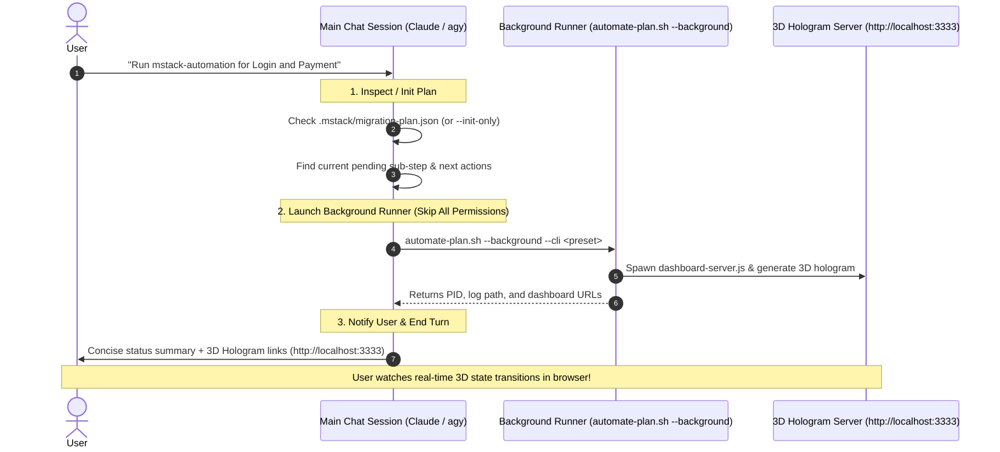
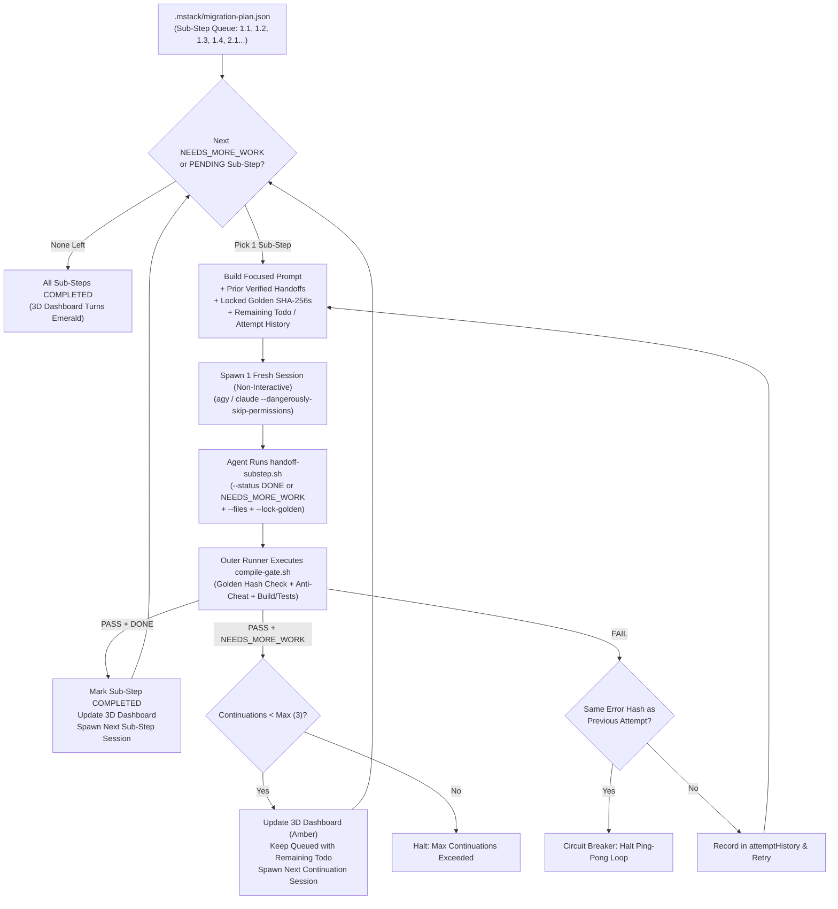

# `mstack-automation` — 3D Hologram Visualization & Non-Interactive Automation

## 1. Golden Rule for Interactive Sessions (Claude, Antigravity, Cursor)

When the user asks to execute or run **`mstack-automation`** inside an interactive chat session (e.g. Claude session, Cursor, Antigravity):

> **THE MAIN SESSION DOES NOT RUN MIGRATION STEPS IN THE CHAT.**
> Instead, the main session performs **three quick actions**, launches the background runner, and notifies the user to watch the real-time **3D Hologram Dashboard**:



### The 3 Mandatory Actions of the Main Session:

1. **Find Current Step & Next Actions**:
   Inspect `.mstack/migration-plan.json` (or initialize if not yet created via `./mobile-migration-tools/scripts/automate-plan.sh --init-only --features "<Feature>"`).
   Identify:
   - The current active/pending sub-step (e.g. `login-step1-1: Characterize Legacy Logic & Record Golden Master Baseline`).
   - Immediate next actions and remaining items.
   - Overall pipeline counts (e.g. `0 Done, 24 Queued`).

2. **Fire Detached Background Automation (All Permissions Skipped)**:
   Launch the runner in detached background mode with permission skipping enabled:
   ```bash
   npx mobile-migration-tools automate --background --cli claude
   # or with agy:
   npx mobile-migration-tools automate --background --cli agy
   # or with gemini:
   npx mobile-migration-tools automate --background --cli gemini
   ```
   *Note: In non-interactive mode, all CLI runners auto-skip permissions (`--dangerously-skip-permissions` for Claude and agy, `--yolo` for Gemini, `--full-auto` for Codex).*

3. **Notify User & Direct to 3D Dashboard**:
   Respond with a clear, concise summary and direct the user to the **3D Hologram Dashboard**:
   - **Current Task**: `<Feature> — Sub-Step <X.Y>: <Title>`
   - **Next Actions**: `<Summary of next queued steps>`
   - **3D Dashboard URL**: `http://localhost:3333` (or `file://<workspace>/.mstack/dashboard/index.html`)
   - **Monitoring Command**: `npx mobile-migration-tools automate --status`
   - **Stop Command**: `npx mobile-migration-tools automate --stop`

---

## 2. The 3D Hologram Dashboard (`.mstack/dashboard/`)

`mstack` includes a futuristic 3D WebGL / Three.js interactive hologram dashboard that visualizes each feature pipeline and state transition in real time.

```
       [ 3D SPATIAL PIPELINE VIEW ]
  
  Feature: Login
  [1.1] ──── [1.2] ──── [1.3] ──── [1.4] ──── [2.1] ...
   ▲          ▲          ▲
COMPLETED  RUNNING    PENDING
 (Emerald)  (Cyan)    (Glass)
  Crystal   Reactor    Block
```

### 3D Representations for Each State:
| State | 3D Visual Geometry & Shader | Animation & Particle Effects |
| :--- | :--- | :--- |
| **`COMPLETED`** | Emerald Octahedron Crystal | Stable levitation, rotating halo, solid glowing emerald conduit |
| **`IN_PROGRESS`** | Cyan Plasma Reactor Core | Dual counter-rotating gimbal rings, pulsing energy laser, orbital satellites |
| **`NEEDS_MORE_WORK`** | Amber Kinetic Dodecahedron | Pulsing warning aura, continuation badge (`cont: X/3`) |
| **`FAILED`** | Shattered Obsidian / Ruby Prism | Flashing red warning beacon, distressed geometry, failure inspector |
| **`PENDING`** | Frosted Cyber-Glass Monolith | Translucent idle box with soft wireframe outline |

### Dashboard Features:
- **Interactive 3D Navigation**: Orbit, pan, and zoom with mouse or touch. Camera angle presets: `Isometric`, `Top-Down`, `Side Flyby`, `Front Grid`.
- **Focus Active Step**: Click `🎯 Focus Active` to smoothly fly the camera straight to the currently executing sub-step.
- **Node Inspector Drawer**: Click any 3D node to open a glassmorphism HUD showing its goal, required principles, verified files touched, locked Golden Master SHA-256 hashes, handoff summaries, and error logs.
- **Dual Connection Modes**:
  1. **Live HTTP Server**: Serves on `http://localhost:3333` with live auto-refresh every 1.5 seconds.
  2. **Zero-CORS Local File**: Opens directly via `file://.../.mstack/dashboard/index.html` with dynamic script-tag reloading (no browser CORS blocks).
- **Holographic Audio**: Optional synthesized SFX using Web Audio API (chimes on sub-step completion, tones on failure).

To manually start or view the dashboard:
```bash
npx mobile-migration-tools dashboard --port 3333 --open
```

---

## 3. Automation Architecture & Circuit Breakers

Running an entire migration phase in a single session causes **quadratic token bloat** and **late-session fatigue**. `mstack-automation` solves this by spawning **1 fresh non-interactive CLI session per 1 sub-step** with verified handoffs and 5 anti-slop circuit breakers:



### The 5 Anti-Slop Circuit Breakers:
1. **Immutable Golden Master SHA-256 Locks**: Baselines locked in `1.1`, `2.1`, and `3.1` are checksum-verified by `compile-gate.sh`. Agents cannot overwrite Golden files to fake a pass.
2. **Non-Empty Git Diff Guard**: Sessions that exit without modifying files and without recording a handoff are rejected as `SLOP_NO_OP`.
3. **Bounded Continuations (`--max-continuations 3`)**: Prevents infinite procrastination loops when handing off `NEEDS_MORE_WORK`.
4. **Anti-Ping-Pong Error Memory**: Re-injects previous failure error tails and halts immediately if two consecutive attempts produce an identical error hash.
5. **Phase Boundary & `@Ignore` Guard**: Rejects changes that add `@Ignore`/`@Disabled` or modify Legacy XML layouts during Step 1.

---

## 4. CLI Command Cheat Sheet

### Start Unattended Automation in Background (Preferred):
```bash
# Using Claude Code (skips all permissions):
npx mobile-migration-tools automate --features "Login,Payment" --background --cli claude

# Using Antigravity CLI (agy):
npx mobile-migration-tools automate --features "Login,Payment" --background --cli agy

# Using Gemini CLI:
npx mobile-migration-tools automate --features "Login,Payment" --background --cli gemini
```

### Inspect Live Status:
```bash
# Print formatted CLI table of all sub-steps, handoff notes, and remaining todos:
npx mobile-migration-tools automate --status
```

### Terminate Running Background Automation:
```bash
# Stop background process cleanly and release locks:
npx mobile-migration-tools automate --stop
```

### Launch or Open 3D Hologram Dashboard:
```bash
# Start local server and open in browser:
npx mobile-migration-tools dashboard --open
```

### Reset Failed Steps & Resume:
```bash
npx mobile-migration-tools automate --reset-failed --background --cli claude
```
