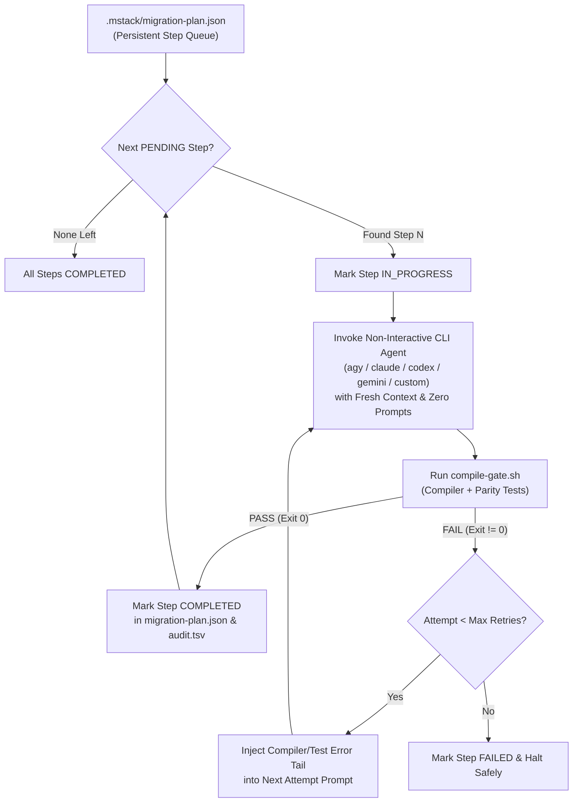

# `mstack-automation` — Long-Running Non-Interactive Migration Mode

## Why Skills Normally Stop After 1 Migration Step

AI agents stop after completing 1 migration step for two structural reasons:
1. **Single-Turn Checkpoint Bias**: By default, skills pause at the end of a phase to present a summary or ask for user approval before moving to the next phase.
2. **Context Window Exhaustion**: Running 4 phases × 4 sub-steps across multiple features inside a single conversation fills the context window with compiler logs and diffs, causing the model to wrap up early after finishing Step 1.

`mstack-automation` eliminates both causes with **two complementary execution modes**:
- **Mode A (External Non-Interactive CLI Loop — Recommended for Long-Running / Overnight Runs)**: Uses `./mobile-migration-tools/scripts/automate-plan.sh` (`npx mobile-migration-tools automate`) to persist a queue of steps in `.mstack/migration-plan.json` and invoke **any CLI tool in non-interactive mode** (`agy`, `claude`, `codex`, `gemini`, `aider`, or custom `--cli-cmd`) in a fresh context window per step until 100% of steps are `COMPLETED`.
- **Mode B (In-Session Continuous Loop)**: When running inside an active agent session, the agent reads `.mstack/migration-plan.json` and loops continuously through every `PENDING` step without pausing for user confirmation between steps, stopping only when all steps are `COMPLETED` or an unrecoverable blocker occurs.



---

## Mode A: Long-Running Non-Interactive CLI Runner (`automate-plan.sh`)

You can run any CLI agent headlessly across an entire multi-feature migration plan from your terminal or CI/CD pipeline.

### 1. Initialize & Run with Built-in CLI Presets

```bash
# Antigravity CLI (agy) in non-interactive mode:
npx mobile-migration-tools automate \
  --features "Login,PaymentConfirmation,TransferReceipt" \
  --cli agy

# Claude Code CLI in non-interactive headless mode:
npx mobile-migration-tools automate \
  --features "Login,PaymentConfirmation,TransferReceipt" \
  --cli claude

# OpenAI Codex CLI in full-auto non-interactive mode:
npx mobile-migration-tools automate \
  --features "Login,PaymentConfirmation,TransferReceipt" \
  --cli codex

# Gemini CLI in non-interactive YOLO mode:
npx mobile-migration-tools automate \
  --features "Login,PaymentConfirmation,TransferReceipt" \
  --cli gemini

# Aider CLI in non-interactive mode:
npx mobile-migration-tools automate \
  --features "Login,PaymentConfirmation,TransferReceipt" \
  --cli aider
```

### 2. Run with Any Custom CLI Tool (`--cli-cmd`)

Pass any CLI binary or wrapper script using `--cli-cmd`. Use `{PROMPT_FILE}` or `{PROMPT}` placeholders (or omit placeholders to have the prompt appended as the final argument):

```bash
# Pass prompt via file placeholder:
npx mobile-migration-tools automate \
  --features "PaymentConfirmation" \
  --cli-cmd 'my-custom-cli run --non-interactive --prompt-file {PROMPT_FILE}'

# Pass prompt string directly:
npx mobile-migration-tools automate \
  --features "PaymentConfirmation" \
  --cli-cmd 'cursor-agent --headless --prompt {PROMPT}'
```

### 3. Inspect Queue Status or Resume After Interruption

Because state is persisted in `.mstack/migration-plan.json` after every step, you can Ctrl+C at any time and resume later without losing progress:

```bash
# View current step queue status:
npx mobile-migration-tools automate --status

# Reset any FAILED/IN_PROGRESS steps and resume:
npx mobile-migration-tools automate --reset-failed --cli claude
```

---

## Mode B: In-Session Continuous Execution Protocol (Never Stop After 1 Step)

When the user asks you in chat to *"run in automation mode"*, *"don't stop after 1 step"*, or *"complete all migration steps continuously"*:

### Mandatory Non-Stop Rules for the Agent

1. **Zero Mid-Plan Checkpoints**:
   - Do **NOT** call `ask_question` or pause for human approval between Step 1, Step 2, Step 3, or Step 4.
   - If `.mstack/target-profile.json` is missing and the user requested non-interactive mode, generate it automatically via `./mobile-migration-tools/scripts/automate-plan.sh --init-only --features "<Feature>"` using the detected project defaults.
2. **Initialize `.mstack/migration-plan.json` First**:
   - Before writing code, ensure all requested features and phases (`step1`, `step2`, `step3`, and optionally `step4-cutover`) are queued in `.mstack/migration-plan.json`:
     ```bash
     ./mobile-migration-tools/scripts/automate-plan.sh --init-only --features "<Feature1>,<Feature2>"
     ```
3. **Continuous Step Loop (Do Not Yield Your Turn Early)**:
   - While any step in `.mstack/migration-plan.json` has `"status": "PENDING"`:
     1. Mark the step `"IN_PROGRESS"` in `.mstack/migration-plan.json`.
     2. Execute all sub-steps of that phase's skill (`mstack-step1-logic-storage`, `mstack-step2-ui-parity`, `mstack-step3-navigation-adaptive`, or `mstack-step4-greenfield-cutover`).
     3. Run `./mobile-migration-tools/scripts/compile-gate.sh` after each atomic sub-step.
     4. If `compile-gate.sh` fails, self-heal and re-run until `COMPILE_PASSED`.
     5. Mark the step `"COMPLETED"` in `.mstack/migration-plan.json` and **immediately begin the next `PENDING` step in the same turn** (or spawn a fresh subagent/CLI invocation per step so context never fills up).
4. **Only Permitted Stop Conditions**:
   - **All steps** in `.mstack/migration-plan.json` have reached `"status": "COMPLETED"`, OR
   - A step has failed `compile-gate.sh` more than `MAX_RETRIES` (3) consecutive times and cannot be resolved automatically.

