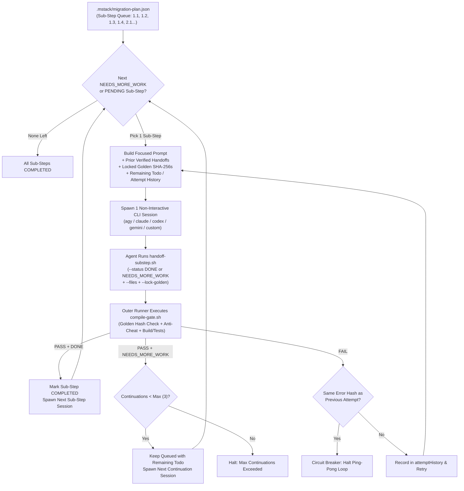

# `mstack-automation` — Sequential 1-Sub-Step-Per-Session Automation & Handoff

## Why `mstack-automation` Runs 1 Sub-Step per Session with Verified Handoffs

Running an entire migration phase (4 sub-steps) in a single session causes **quadratic token bloat** and **late-session fatigue** (where the agent rushes or stubs Sub-Steps `.3` and `.4`).

`mstack-automation` solves this with **three core mechanisms**:
1. **Sequential 1-Sub-Step-Per-Session Execution**: Expands every feature into atomic sub-steps (`1.1`, `1.2`, `1.3`, `1.4`, `2.1`, `2.2`, `2.3`, `2.4`, `3.1`, `3.2`, `3.3`, `3.4`) in `.mstack/migration-plan.json` and spawns **1 fresh non-interactive CLI session per 1 sub-step**.
2. **Verified Agent-to-Agent Handoff (`handoff-substep.sh`)**: Every sub-step session must record what it completed (`--summary`, fact-checked `--files`, and `--lock-golden`). If a sub-step requires more work than fits in 1 session, the agent compiles its partial slice and calls `handoff-substep.sh --status NEEDS_MORE_WORK --remaining "todo1|todo2"` (or `--spawn-substep "<title>"`) so the next spawned session picks up seamlessly.
3. **5 Anti-Slop Circuit Breakers**:
   - **Immutable Golden Master SHA-256 Locks**: Golden JSON/PNG files locked in `1.1`, `2.1`, and `3.1` are hash-verified by `compile-gate.sh` in `1.3`, `2.3`, and `3.4`. Agents cannot overwrite Golden baselines to fake a pass.
   - **Non-Empty Git Diff Guard**: Sessions that exit without changing any files or recording a handoff are rejected as `SLOP_NO_OP`.
   - **Bounded Continuations (`--max-continuations 3`)**: Prevents infinite procrastination loops when handing off `NEEDS_MORE_WORK`.
   - **Cumulative Attempt History & Ping-Pong Circuit Breaker**: Injects all prior failed attempts into retries and halts immediately if two consecutive attempts produce the identical error hash.
   - **Phase Boundary & `@Ignore` Guard**: Rejects `git diff` changes that add `@Ignore`/`@Disabled` to tests or modify Legacy UI XML/Storyboards during Step 1.



---

## Mode A: External Non-Interactive CLI Runner (`automate-plan.sh`)

### 1. Run Unattended Across All Sub-Steps (`1 Sub-Step = 1 Session`)

```bash
# Antigravity CLI (agy) — 1 sub-step per session:
npx mobile-migration-tools automate \
  --features "Login,PaymentConfirmation,TransferReceipt" \
  --cli agy

# Claude Code CLI:
npx mobile-migration-tools automate \
  --features "Login,PaymentConfirmation,TransferReceipt" \
  --cli claude

# OpenAI Codex CLI:
npx mobile-migration-tools automate \
  --features "Login,PaymentConfirmation,TransferReceipt" \
  --cli codex

# Gemini CLI:
npx mobile-migration-tools automate \
  --features "Login,PaymentConfirmation,TransferReceipt" \
  --cli gemini

# Any custom CLI command template:
npx mobile-migration-tools automate \
  --features "PaymentConfirmation" \
  --cli-cmd 'my-custom-cli run --headless --prompt-file {PROMPT_FILE}'
```

### 2. How Each Sub-Step Session Hands Off Work (`handoff-substep.sh`)

Before exiting a sub-step session, the agent updates `.mstack/migration-plan.json` using `./mobile-migration-tools/scripts/handoff-substep.sh`:

- **When the sub-step is 100% complete (`DONE`)**:
  ```bash
  ./mobile-migration-tools/scripts/handoff-substep.sh \
    --step-id "paymentconfirmation-step1-1" \
    --status DONE \
    --summary "Captured 64 Golden Master cases from LegacyPaymentCalculator" \
    --files "features/payment/impl/src/test/kotlin/PaymentGoldenTest.kt" \
    --lock-golden "features/payment/impl/src/test/resources/payment_golden.json"
  ```

- **When the sub-step needs more work and hands off to the next spawned agent (`NEEDS_MORE_WORK` or `--spawn-substep`)**:
  ```bash
  ./mobile-migration-tools/scripts/handoff-substep.sh \
    --step-id "paymentconfirmation-step1-3" \
    --status NEEDS_MORE_WORK \
    --summary "Implemented PaymentDomainModel and FeeCalculatorUseCase (42/64 golden cases passing)" \
    --files "features/payment/api/PaymentModels.kt,features/payment/impl/FeeCalculatorUseCase.kt" \
    --remaining "Implement CurrencyRoundingMapper for TH locale|Pass remaining 22 golden test cases"
  ```

### 3. Inspect Queue Status, Handoff Notes, and Locked Goldens

```bash
# View live sub-step status, last handoff summary, and remainingTodo for next agent:
npx mobile-migration-tools automate --status

# Reset any FAILED/IN_PROGRESS sub-steps and resume:
npx mobile-migration-tools automate --reset-failed --cli agy
```

---

## Mode B: In-Session Execution & Handoff Protocol

When running inside an interactive or background session where the user asks to execute current required steps and hand off sub-steps sequentially:
1. Initialize the sub-step plan if not yet created:
   ```bash
   ./mobile-migration-tools/scripts/automate-plan.sh --init-only --features "<Feature>"
   ```
2. Pick the current required sub-step from `.mstack/migration-plan.json`, execute it cleanly, and verify with `./mobile-migration-tools/scripts/compile-gate.sh`.
3. Record what was done and any remaining work via `./mobile-migration-tools/scripts/handoff-substep.sh`.
4. Trigger or spawn the non-interactive sequential sub-step runner (`./mobile-migration-tools/scripts/automate-plan.sh --cli <cli>`) to execute the remaining sub-steps 1 sub-step per 1 session.
