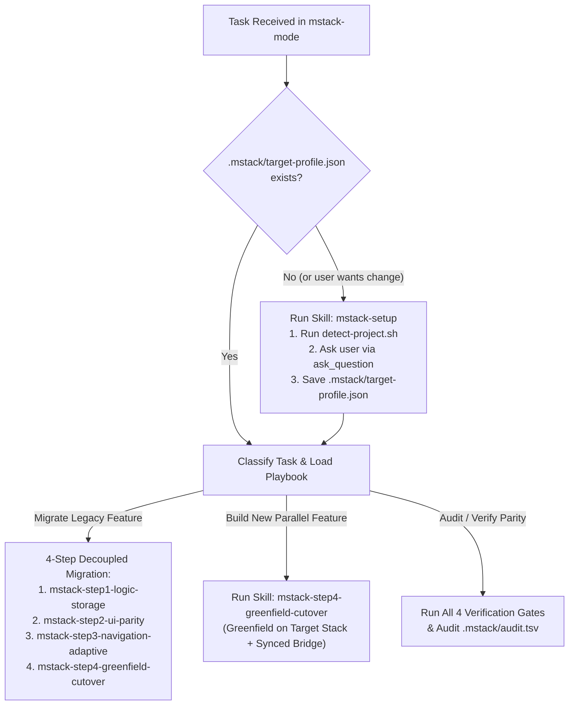

# `mstack-mode` — Mobile Migration Orchestrator

Inspired by `poteto/pstack`, `mstack-mode` is the front-door router that ensures every mobile migration or parallel feature task executes with **zero guesswork, 100% parity proof, and compilation at every atomic step**.

---

## Mandatory Execution Protocol

### 1. Check Target Profile First (`mstack-setup`)
- Check if `.mstack/target-profile.json` exists in the workspace root.
- If it is missing, **stop immediately** and execute [`mstack-setup`](../mstack-setup/SKILL.md) to detect the current project and ask the user to select their target architecture and stack via `ask_question`.

### 2. Copy Playbook Steps into Your Active Checklist
Never improvise a migration sequence. Match the user's request to the exact playbook below:

- **Migrating an Existing Feature / Screen (End-to-End or Phased)**:
  1. **Step 1 (`mstack-step1-logic-storage`)**: Extract business logic & storage using Golden Master Approval Tests + Scientist Dual-Execution + Synced Storage Proxy (UI & Navigation untouched). **Run `compile-gate.sh`**.
  2. **Step 2 (`mstack-step2-ui-parity`)**: Capture Legacy View Golden PNG, build declarative UI with Bridge Theme, pass `<= 0.1%` pixel diff, and swap inside existing navigation host (`ComposeView` / `UIHostingController`). **Run `compile-gate.sh`**.
  3. **Step 3 (`mstack-step3-navigation-adaptive`)**: Upgrade internal routing to the target navigation stack (e.g., Navigation 3 + Adaptive Foldable Scenes), pass JVM/unit backstack state-machine tests, configuration recreate tests, and E2E Maestro tests. **Run `compile-gate.sh`**.
  4. **Step 4 (`mstack-step4-greenfield-cutover`)**: Only after user approval and 0% Scientist/Visual/Nav diffs, decommission dead legacy files in a dedicated cleanup step. **Run `compile-gate.sh`**.

- **Building a New Feature During Ongoing Migration**:
  - Execute [`mstack-step4-greenfield-cutover`](../mstack-step4-greenfield-cutover/SKILL.md) (Greenfield Track) to scaffold in the target multi-module architecture and connect to legacy callers via a single bridge hook and synced storage proxy.

### 3. Enforce the Four Principles at Every Step
At the end of every phase or response, state explicitly:
1. **Which `mstack` principles were applied** (`principle-always-compile`, `principle-scientist-parity`, `principle-visual-golden-master`, `principle-decouple-ui-and-nav`).
2. **Which compile & test gates were executed** via `./mobile-migration-tools/scripts/compile-gate.sh` and their exact exit status / test counts.
3. **What was NOT verified** (e.g., if physical foldable device hardware was unavailable and verified via JVM Roborazzi / Robolectric instead).
