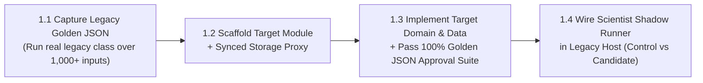

# `mstack-step1-logic-storage` — Step 1: Business Logic & Storage Extraction

**Required Principles:** [`principle-always-compile`](../principle-always-compile/SKILL.md), [`principle-scientist-parity`](../principle-scientist-parity/SKILL.md)

**Golden Rule of Step 1:** Legacy UI (XML/Storyboards) and Legacy Navigation (Activities/Fragments/ViewControllers) remain **100% untouched** in this step. You are only extracting and verifying data, storage, and domain logic.



---

## Execution Checklist (Compile After Every Sub-Step)

### Sub-Step 1.1: Characterize Legacy Logic & Record Golden Master
1. Identify all legacy classes involved in the feature's business logic, calculations, formatting, validation, and data mapping.
2. Check git history for historical bug fixes and edge cases:
   ```bash
   git log -p -S "<LegacyClassOrMethod>"
   ```
3. Write a **Golden Master Characterization Test** that invokes the **real legacy Java/Kotlin/Obj-C methods** across an exhaustive input matrix:
   - Standard valid inputs
   - Financial/decimal rounding boundaries (`1.005`, `0.005`, `-0.005`, `0`, `MAX_VALUE`, `MIN_VALUE`, comma strings)
   - Nulls, empty collections, unknown enum strings, error codes (`401`, `4xx`, `500`, timeout)
   - Localization variants (e.g., EN and TH formatting)
4. Record the serialized outputs as the Golden Master baseline.
5. **Compile & Test Gate**:
   ```bash
   ./mobile-migration-tools/scripts/compile-gate.sh "step1-1-golden-baseline" "principle-always-compile,principle-scientist-parity" "Recorded Golden Master baseline from legacy logic"
   ```

### Sub-Step 1.2: Scaffold Target Module Pair & Synchronized Storage Proxy
1. Scaffold the target module structure defined in `.mstack/target-profile.json` (e.g., `:features:<name>:api` + `:features:<name>:impl`).
2. **Device Storage Bridge (Zero Split-Brain)**:
   - Define a pure storage contract in `:api` / `:core:data`.
   - Implement a **Read-Through / Dual-Write Storage Proxy** that writes to both the legacy store (`SharedPreferences` / legacy DB) and the modern target store (`DataStore` / `Room KMP`).
   - Write a unit test proving that data written via legacy is readable via the modern contract and vice versa.
3. **Compile Gate**:
   ```bash
   ./mobile-migration-tools/scripts/compile-gate.sh "step1-2-scaffold-storage" "principle-always-compile,principle-scientist-parity" "Scaffolded target modules and synced storage proxy"
   ```

### Sub-Step 1.3: Implement Target Domain & Data Layer (100% Golden Match)
1. Implement pure domain models, value classes, mappers, repository, and UseCases in the target module (`commonMain`).
2. Run the **exact same Golden Master Approval Test suite** from Sub-Step 1.1 against the new target implementation.
3. **Gate Criteria**: **100.0% of test cases must match** the legacy Golden Master output. If any edge case differs, fix the target mapper/calculation before proceeding.
4. **Compile & Test Gate**:
   ```bash
   ./mobile-migration-tools/scripts/compile-gate.sh "step1-3-domain-parity" "principle-always-compile,principle-scientist-parity" "Target domain and data passed 100% of Golden Master approval cases"
   ```

### Sub-Step 1.4: Wire the "Scientist" Dual-Execution Runner
1. Connect the legacy presenter/ViewModel/Activity to a lightweight `Scientist` shadow wrapper:
   - Executes **Legacy (`Control`)** and **New Target (`Candidate`)** in parallel on real runtime/test data.
   - Compares `Control == Candidate` and logs any discrepancy while returning `Control` (or switching to `Candidate` once verified).
2. **Compile & Test Gate**:
   ```bash
   ./mobile-migration-tools/scripts/compile-gate.sh "step1-4-scientist-wired" "principle-always-compile,principle-scientist-parity" "Wired Scientist shadow execution in legacy host with 0% mismatch"
   ```
