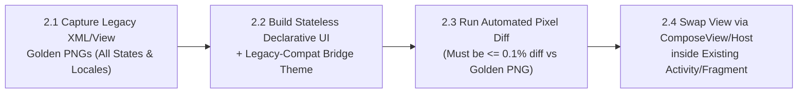

# `mstack-step2-ui-parity` — Step 2: Pixel-Exact UI Migration (Navigation Untouched)

**Required Principles:** [`principle-always-compile`](../principle-always-compile/SKILL.md), [`principle-visual-golden-master`](../principle-visual-golden-master/SKILL.md), [`principle-decouple-ui-and-nav`](../principle-decouple-ui-and-nav/SKILL.md)

**Golden Rule of Step 2:** Do **not** change navigation routing, Intent flags, `startActivityForResult`, or Fragment transactions in this step. You are only replacing the visual layout inside the existing screen host after proving `<= 0.1%` pixel diff against the real legacy layout.



---

## Execution Checklist (Compile After Every Sub-Step)

### Sub-Step 2.1: Capture Golden Master PNGs of the Real Legacy View
1. Enumerate every visual state of the legacy screen (`Loading`, `Loaded/Content`, `Empty`, `ValidationError`, `NetworkError`) and every supported locale (e.g., `en` and `th`).
2. Audit legacy layout quirks before coding:
   - Custom Views that override XML attributes in code.
   - Dimension resource semantics (e.g., check if any `dp` resources are used as non-scaling text sizes or if `res/anim` uses raw pixels).
   - Font padding (`includeFontPadding`), line spacing, and ellipsize rules.
   - Accessibility IDs / `android:id` selectors used by QA and Maestro tests.
3. Write a JVM/snapshot test (using **Roborazzi** / **Paparazzi** / **SnapshotTesting**) that inflates the **real untouched legacy XML/View** for each state and locale and records `golden_legacy_<state>_<locale>.png`.
4. **Compile & Record Gate**:
   ```bash
   ./mobile-migration-tools/scripts/compile-gate.sh "step2-1-legacy-golden-png" "principle-always-compile,principle-visual-golden-master" "Captured Golden Master PNGs from real legacy view"
   ```

### Sub-Step 2.2: Implement Stateless Declarative UI + Bridge Theme
1. Build the stateless `<Screen>Content(state, onEvent)` in the target module (`:features:<name>:impl`).
2. Apply the **Legacy-Compat Bridge Theme** so rendering matches legacy defaults:
   - Match exact font metrics (`PlatformTextStyle(includeFontPadding = true)` on Android Compose where legacy `TextView` used default font padding).
   - Reference exact colors, typography, and dimensions.
   - Preserve exact test identifiers (`Modifier.semantics { testTagsAsResourceId = true }` + `Modifier.testTag("<legacy_xml_id>")`) so existing E2E Maestro tests continue to find every element by its original ID.
3. **Hybrid Escape Hatch (`AndroidView` / `UIViewRepresentable`)**:
   - If the screen contains a complex legacy custom View (e.g., hardware camera preview, complex canvas chart, legacy PDF renderer), wrap it via `AndroidView` / `UIViewRepresentable` first so the screen achieves 100% parity immediately.
4. **Compile Gate**:
   ```bash
   ./mobile-migration-tools/scripts/compile-gate.sh "step2-2-declarative-ui" "principle-always-compile,principle-visual-golden-master" "Built stateless declarative UI with legacy bridge theme and test IDs"
   ```

### Sub-Step 2.3: Run Automated Pixel-Diff Gate (`<= 0.1%` Tolerance)
1. Render `<Screen>Content(state, ...)` in the snapshot test harness under the **exact same width, height, density, and locale** as `golden_legacy_<state>_<locale>.png`.
2. Execute the pixel comparison task.
3. **Gate Criteria**: Pixel difference must be **`<= 0.1%`**. If any shift occurs in margins, text baseline, or colors, inspect the generated diff PNG, fix `<Screen>Content`, and re-run until green.
4. **Compile & Snapshot Gate**:
   ```bash
   ./mobile-migration-tools/scripts/compile-gate.sh "step2-3-pixel-diff-gate" "principle-always-compile,principle-visual-golden-master" "Verified <= 0.1% pixel diff between Legacy XML PNG and New Declarative UI PNG"
   ```

### Sub-Step 2.4: Swap View Inside Existing Navigation Host
1. Inside the existing `Activity` / `Fragment` / `UIViewController`, replace the legacy view inflation (`setContentView` / `onCreateView`) with `ComposeView` / `setContent` / `UIHostingController` hosting the new screen.
2. Keep **all** existing `Intent` extras, `startActivityForResult`, `setResult`, and lifecycle callbacks in the host shell untouched.
3. Verify state restoration across configuration change (`ActivityScenario.recreate()`).
4. **Compile & Host Gate**:
   ```bash
   ./mobile-migration-tools/scripts/compile-gate.sh "step2-4-host-ui-swap" "principle-always-compile,principle-decouple-ui-and-nav" "Swapped legacy view for declarative UI inside existing navigation host"
   ```
