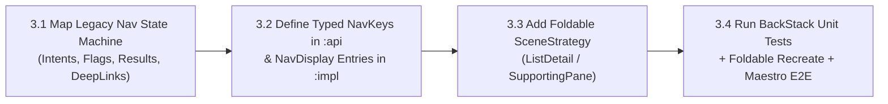

# `mstack-step3-navigation-adaptive` — Step 3: Navigation 3 & Foldable Adaptive Upgrade

**Required Principles:** [`principle-always-compile`](../principle-always-compile/SKILL.md), [`principle-decouple-ui-and-nav`](../principle-decouple-ui-and-nav/SKILL.md)

**Precondition:** All screens in the target flow have already completed **Step 1 (100% Logic/Storage Parity)** and **Step 2 (100% Visual UI Parity inside legacy hosts)**. Now—and only now—we consolidate their internal navigation into the modern navigation stack and enable foldable posture support.



---

## Execution Checklist (Compile After Every Sub-Step)

### Sub-Step 3.1: Extract the Legacy Navigation State Machine
1. Document every transition inside the flow before writing navigation code:
   - Entry contract: Inbound `Intent` extras, deep-link URIs, auth/session gates.
   - Internal transitions: Standard push, `FLAG_ACTIVITY_CLEAR_TOP`, `FLAG_ACTIVITY_SINGLE_TOP`, modal dialogs/bottom sheets.
   - Result contracts: `startActivityForResult` / `setResult(RESULT_OK, data)` payloads returned to callers.
   - Back behavior: Custom `onBackPressed` overrides, unsaved-form confirmation dialogs, system/predictive back.
2. Record a baseline **Maestro E2E flow** (or UI test) against the Step 2 build covering Happy Path, Validation, Error, and Back navigation.

### Sub-Step 3.2: Implement Target Navigation (`NavKey` + `NavDisplay`)
1. In `:features:<name>:api`:
   - Define `@Serializable` routes implementing `NavKey` (carrying only minimal validated IDs/primitives, never full domain models or PII).
   - Define the single Inbound/Outbound bridge interface (`<Feature>Navigator` / `<Feature>InboundNavigation`) for crossing into or out of unmigrated legacy flows.
2. In `:features:<name>:impl`:
   - Register screen entries via `EntryProviderScope<NavKey>` and scope ViewModels to each `NavEntry` (`lifecycle-viewmodel-navigation3`).
   - Map every legacy backstack flag to explicit operations on the user-owned `SnapshotStateList<NavKey>` (`rememberNavBackStack`).
3. **Compile Gate**:
   ```bash
   ./mobile-migration-tools/scripts/compile-gate.sh "step3-2-navkey-entries" "principle-always-compile,principle-decouple-ui-and-nav" "Implemented typed NavKey routes and NavDisplay entry providers"
   ```

### Sub-Step 3.3: Enable Foldable & Large-Screen Adaptive Scenes (`SceneStrategy`)
1. Attach Material 3 Adaptive `SceneStrategy` to `NavDisplay` (`org.jetbrains.compose.material3.adaptive:adaptive-navigation3`):
   - Use `rememberListDetailSceneStrategy()` (`ListDetailSceneStrategy.listPane()` + `detailPane()`) for list-to-detail flows.
   - Use `rememberSupportingPaneSceneStrategy()` (`mainPane()` + `supportingPane()`) for primary-plus-supporting flows.
2. **Phone Parity Rule**:
   - On compact/folded phone width, the `SceneStrategy` **must** collapse to a single pane that behaves and looks 100% identical to the legacy phone flow.
   - On unfolded foldable / tablet width, it automatically renders multi-pane without losing ViewModel state or user input when folding/unfolding.
3. **Compile Gate**:
   ```bash
   ./mobile-migration-tools/scripts/compile-gate.sh "step3-3-foldable-scenes" "principle-always-compile,principle-decouple-ui-and-nav" "Attached foldable adaptive SceneStrategy to NavDisplay"
   ```

### Sub-Step 3.4: Prove Navigation & Foldable Parity (Unit + Recreate + Maestro E2E)
1. **Pure Backstack State-Machine Unit Tests**:
   - Write fast unit tests asserting every push, pop, `clearTop`, `singleTop`, result delivery, and deep-link route serialization round-trip on the `NavKey` backstack.
2. **Fold/Unfold Posture Recreation Test**:
   - Trigger `ActivityScenario.recreate()` / posture change while mid-flow (e.g., with text typed in a detail pane) and assert `rememberNavBackStack` and `rememberSaveable` preserve 100% of state.
3. **Identical Maestro E2E Suite**:
   - Run the **exact same Maestro YAML test suite** from Sub-Step 3.1 against the new Navigation 3 flow. Every assertion must pass without modification.
4. **Compile & Verification Gate**:
   ```bash
   ./mobile-migration-tools/scripts/compile-gate.sh "step3-4-nav-verified" "principle-always-compile,principle-decouple-ui-and-nav" "Verified Navigation 3 backstack unit tests, foldable recreate, and Maestro E2E parity"
   ```
